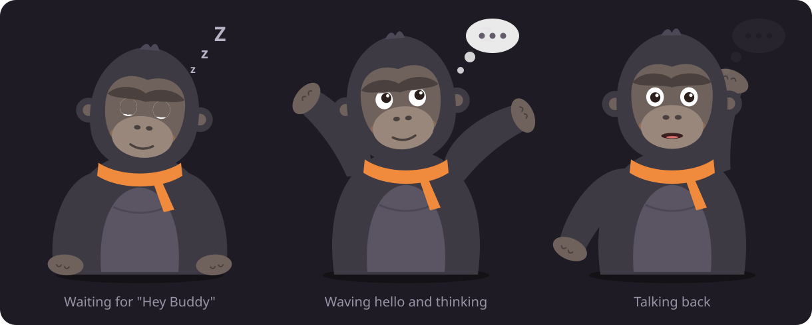

# Buddy

Buddy is a voice assistant you can just talk to, about anything. He's a cartoon gorilla who reacts while you talk: he nods along when you speak, scratches his head while he thinks, and his mouth moves with his voice when he answers. You can cut him off mid-sentence like you would a real person.

It's free to run. By default Buddy's brain is an open-source model running on your own computer with [Ollama](https://ollama.com), his voice is [Piper](https://github.com/OHF-Voice/piper1-gpl) (also running locally), and your browser does the listening. No accounts or API keys needed. If you want, you can also switch to Gemini's free tier, or to Claude or ChatGPT with an API key.




## Features

- Say **"Hey Buddy"** or tap **Hi** to start talking
- Real-time voice conversation, he starts answering about a second after you stop talking
- Interrupt him whenever you want, he stops and listens
- Animated gorilla that reacts when he's listening, thinking, talking or asleep
- Chats are saved, and each chat remembers what you talked about earlier in it
- A few follow-up suggestions after every reply, tap one and he answers it out loud
- Free by default: local AI, local voice, no keys
- Switch between Local, Gemini, Claude and ChatGPT, and between Fast and Smart models
- You can type instead of talking if you want
- Shows how long each step of a reply took

## How it works

```
you talk -> browser speech recognition -> text -> backend
                                                    |
                         the model streams its reply (Ollama / Gemini / Claude / ChatGPT)
                                                    |
                         split into sentences as they come in
                                                    |
                         each sentence -> Piper turns it into speech
                                                    |
browser plays sentence 1 while sentence 2 is still being written
```

The frontend (React) and backend (FastAPI) talk over one WebSocket. The trick that makes it feel quick is not waiting for the whole answer: as soon as the model has written one sentence, that sentence gets turned into speech and sent to the browser, while the model keeps writing the next one.

## Running it

You need Python 3.11+ and Node 18+.

**1. Install Ollama and the models** (once)

Download Ollama from [ollama.com](https://ollama.com/download) and open it, then:

```bash
ollama pull llama3.2:3b
ollama pull llama3.1:8b
```

**2. Backend**

```bash
cd backend
python -m venv .venv
source .venv/bin/activate
pip install -e .
cp .env.example .env
python -m piper.download_voices en_US-ryan-medium --download-dir voices   # Buddy's voice, once
uvicorn app.main:app --reload --reload-dir app
```

**3. Frontend** (in a second terminal)

```bash
cd frontend
npm install
npm run dev
```

Open http://localhost:5173 in Chrome, Edge or Safari, allow the microphone, and say "Hey Buddy".

If you skip the Piper step he still works, he just uses your browser's built-in voice. And `DEMO_MODE=true` in `backend/.env` runs him with made-up replies and a beep voice, handy for trying the UI without Ollama.

**Or with Docker:**

```bash
docker compose up --build
```

and open http://localhost:8080. Ollama still runs on your computer (the container talks to it), and the Piper voice is downloaded into the image.

## Other models (optional)

The Settings screen in the app (the ⚙️ button) shows what's set up, has a button to test each one, and has these same steps.

**Gemini, free tier.** Smarter than the local models and doesn't need a fast computer. Get a free key at [aistudio.google.com/apikey](https://aistudio.google.com/apikey) (no card needed) and put it in `backend/.env` as `GEMINI_API_KEY=...`. The free tier has daily limits.

**Claude or ChatGPT.** These need API keys, which are paid and separate from a Claude or ChatGPT subscription (subscriptions, and logins like Claude Code or Codex, can't be used by other apps).

- Claude: create a key in the [Anthropic Console](https://console.anthropic.com) and add it as `ANTHROPIC_API_KEY=...`. If you use Anthropic's `ant` CLI, `ant auth login` works too.
- ChatGPT: create a key at [platform.openai.com/api-keys](https://platform.openai.com/api-keys), add it as `OPENAI_API_KEY=...`, and set `OPENAI_FAST_MODEL` and `OPENAI_SMART_MODEL` to the models you want. `VOICE_ENGINE=openai` switches the voice and listening to OpenAI as well.

Keys only live in `backend/.env` on your machine. That file is in `.gitignore`, and the app never sends them to the browser.

## Models

| | Fast | Smart |
| --- | --- | --- |
| Local (Ollama) | `llama3.2:3b` | `llama3.1:8b` |
| Gemini | `gemini-3.5-flash-lite` | `gemini-3.8-flash` |
| Claude | `claude-haiku-5-5` | `claude-opus-5-5` |
| ChatGPT | set `OPENAI_FAST_MODEL` | set `OPENAI_SMART_MODEL` |

All of these can be changed in `backend/.env`. On a laptop with 8 GB of memory, stick to the fast local model.

## Notes

**Detecting when you've finished talking.** The browser listens to the mic volume. A bit of loud audio means you started, about 0.8 seconds of quiet means you finished. It keeps the last 0.4 seconds from before you started too, otherwise the first word gets cut off. While Buddy is talking it needs louder and longer sound before it counts as you, so his own voice coming out of the speakers doesn't interrupt him.

**Interrupting.** When you start talking over him, the browser stops the audio and tells the server, which cancels the reply that's still being generated. What he managed to say is saved with a note that he was cut off, so the model knows on the next turn.

**Memory.** Every chat is saved in SQLite. When a chat gets long (over 30 messages), the older part is summarised and Buddy gets the summary plus the recent messages, so he still remembers your name and what you talked about without every request growing forever.

**Listening for free.** The browser's built-in speech recognition turns your voice into text, which also gives live captions while you talk. It's free, but in Chrome it runs on Google's servers (Safari does it on your device). It pauses while Buddy is talking so it doesn't transcribe his own voice. The mic's volume is still used to notice when you start talking over him.

**"Hey Buddy".** Same browser speech recognition, only while Buddy is asleep. Nothing goes to Buddy's backend until he hears it. It works in Chrome, Edge and Safari. In other browsers just tap Hi.

**One client for three providers.** Ollama and Gemini both offer an OpenAI-compatible API, so ChatGPT, Ollama and Gemini all go through the same client with a different address. One detail: if there's no Gemini key, Buddy refuses up front, otherwise the OpenAI SDK would quietly fall back to your OpenAI key and send it to Google.

**Two bugs worth mentioning.** Buddy used to get stuck on his second reply, because the audio player kept counting sentences from the previous one. And interrupting him right after he finished, while the follow-up suggestions were still loading, saved his reply twice. Both have tests now.

## Project structure

```
backend/
  app/
    voice.py          # the WebSocket conversation
    sentences.py      # splits the streamed reply into sentences
    memory.py         # chat history and summaries
    suggestions.py    # follow-up suggestions
    providers/        # Ollama, Gemini, Claude, ChatGPT, Piper and OpenAI speech, and fakes for demo mode
    routers/          # REST endpoints for chats and settings
  tests/
frontend/
  src/
    components/Buddy.jsx   # the gorilla and his animations
    hooks/useBuddy.js      # WebSocket + mic + audio, and his state
    audio/                 # mic, voice detection, browser listening, playback, wake word
```

## Tests

```bash
cd backend
pip install -e ".[dev]"
pytest
```

The tests use fake versions of the AI and speech services, so they run without any keys or a microphone.

## Ideas for later

- Let Buddy look things up (weather, news) with tool calls
- Different voices and personalities
- Local speech-to-text (for example Whisper) so listening works fully offline too
- A proper wake word model that runs locally instead of the browser's speech recognition

Made by Bhargavi Thoka
